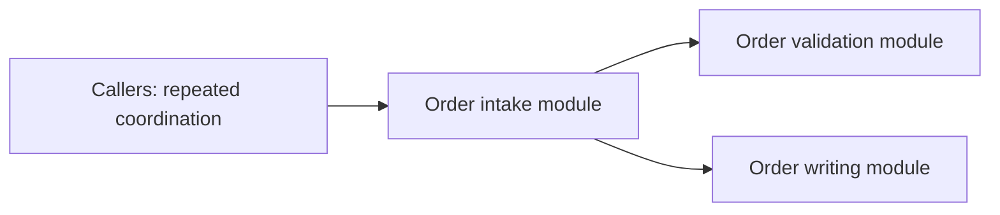
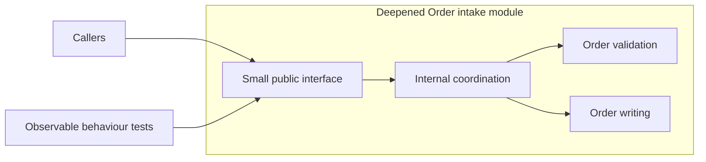

# Architecture Review Report

Present the review in chat as Markdown with fenced Mermaid diagrams. No generated HTML, scripts, external assets, or browser-opening commands.

## Candidate structure

For each numbered candidate:

1. **Title**: name the deepening using domain language.
2. **Recommendation strength**: `Strong`, `Worth exploring`, or `Speculative`.
3. **Files**: actual paths; identify any unverified caller paths rather than inventing them.
4. **Problem**: observed friction and supporting evidence.
5. **Solution**: proposed concentration of responsibilities; defer detailed interface design.
6. **Benefits**: locality, leverage, and observable tests through the interface.
7. **Before** and **After**: separate fenced `mermaid` diagrams.
8. **ADR conflict** if applicable, and material unknowns.

Keep prose concise. State whether each structure is current or proposed. Do not infer execution order from a call graph or invent transaction, retry, or error guarantees.

## Diagram example

Illustrative Order intake deepening; use actual module names and relationships from the reviewed codebase.

**Before — current structure**

**After — proposed responsibility placement**

Use flowcharts for dependencies and responsibility placement; use sequence diagrams only when sequencing is established. Label seams and adapters when they are relevant and justified. Quote node labels and use simple IDs; meaning must not depend on colour, CSS, animation, or side-by-side layout.

Depth is leverage at the interface, not rectangle size or implementation line count. Explain caller obligations and hidden behaviour in prose or a small table when a graph cannot convey them accurately.

## Top recommendation

Name the candidate to explore first and give the evidence-backed reason. This ranks discovery candidates, not unchosen interface designs. Ask which candidate the user wants to explore unless selection is already settled.
