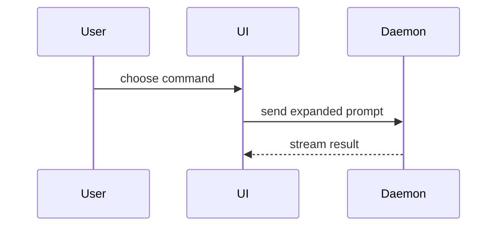

# PR Body

Write a reviewable description of the actual change, using the [shared policy](../../references/POLICY.md).

## Before drafting

- Inspect the intended diff and relevant implementation; separate unrelated user changes. Gather existing verification results and known limitations rather than treating a plan as shipped behavior.
- Discover the repository's PR template and contribution conventions. Preserve required sections; fit the content below into that structure when a template exists.
- Use established domain vocabulary from relevant project docs or a glossary when present. A missing `GLOSSARY.md` does not require creating one.
- This skill owns the body, not code review or Git operations. Use [code-review-and-quality](../code-review-and-quality/SKILL.md) for a requested review and [git-workflow-and-versioning](../git-workflow-and-versioning/SKILL.md) for branch, commit, and publication workflow. Drafting does not authorize creating or updating a remote PR, pushing, or merging. Return inline Markdown unless another destination is requested.

## Default template

Use this structure when the repository does not require another:

```markdown
## Summary

<diagram, diff-sketch, or tree>

## Evidence

- <exact check or observed scenario and result; before/after when captured>
- <relevant checks not run or evidence limits, with reasons; omit when none>

## Merge Danger

**Door:** <one-way, two-way, or unknown> — <rollback path or irreversible effect>

**Blast Radius:** <affected users, consumers, modules, or data; relevant failure modes>
```

## Sections

Skip preambles and keep prose brief. Explain the outcome and why it matters, not just which files changed.

### Summary

Pick the smallest view that makes the key point clear.

- Show logic or an algorithm as pseudocode:

```text
on(save)
  if content is unchanged
    return cached result
  write new content
  return fresh result
```

- Show runtime control flow as a call tree:

```text
submitForm
  createSession
    persistPrompt
    launchAgent
  navigateToSession
```

- Show UI structure as a component tree, including state and module boundaries that matter:

```text
<SessionPage> (apps/example/src/routes/session.tsx)
  useSessionEvents()
  <SessionToolbar>
    <RunSkillButton> (packages/ui)
```

- Show file responsibility or a broad refactor as a shallow file tree:

```text
src/
├── commands/       # parses user actions
├── sessions/       # owns session state
└── transport/      # sends API requests
```

- Show component interaction, control flow, or data flow with Mermaid:



- Use `diff` when the point is what changes and the surrounding shape already exists. Match the diff shape to the topic.

For a component change:

```diff
 <SessionPage>
   useSessionEvents()
   <SessionToolbar>
+    <RunSkillButton />
   <SessionTimeline>
+    <SkillResultCard />
```

For a file-layout change:

```diff
 src/
 ├── commands/
+│   └── show-me.ts       # expands the slash command
 ├── sessions/
-└── transport.ts
+└── transport/
+    ├── client.ts
+    └── stream.ts
```

For a call-tree or call-stack change:

```diff
 submitForm
   createSession
     persistPrompt
+    expandSkillMention
     launchAgent
-  navigateToSession
+  navigateToSession
+    subscribeToEvents
```

For a state or control-flow change:

```diff
 on(save)
-  write content
+  if content is unchanged
+    return cached result
+  write new content
+  invalidate cache
```

- Show the whole block when most of it is new, when omitted context would hide ownership or order, or when the user needs a copyable target shape:

```ts
function expandSkill(command: string): string {
  const skillName = command.slice(1);
  return `use the ${skillName} skill`;
}
```

#### Guidance

Place each visual next to the short text it supports. Keep only the calls, files, props, states, and boundaries needed to answer the user's current question or the options to resolve the current discussion point.

You may use one of these, you may use several, it is unlikely you will use all of them. Use your judgement and don't overwhelm the user.

### Evidence

Report observed evidence with the exact command or scenario and its result. Use captured before/after output for a bug fix or behavioral comparison; if the baseline was not captured, say so and report only the observed after-state. Keep actual output distinct from illustrative pseudocode.

For visual changes, include available screenshots and the interaction or state they show. For logic, API, or tooling changes, use relevant execution output. Documentation-only changes can cite reference checks and representative instruction walkthroughs; do not imply application tests ran.

Identify relevant checks not run, unavailable screenshots, and other evidence limits with their reasons. Missing evidence means uncertainty, not a passing check. Redact secrets and private provider or user data from output and images.

### Merge Danger

Classify rollback from the actual effects, not diff size. A two-way door has a concrete rollback path; explain it. A one-way door includes destructive data changes or external effects that reverting code cannot undo; name what cannot be recovered. Use `unknown` when rollback has not been established, and state the missing information.

Describe the bounded blast radius: affected users, consumers, modules, or stored data and plausible failures. Mention compatibility, migrations, or deployment ordering when relevant. Distinguish known effects from unresolved risks rather than listing unrelated possibilities.

## Verification

- The body covers the intended diff and respects required repository sections.
- The summary explains the outcome; visuals show relevant ownership, ordering, or behavior.
- Evidence identifies observed checks and limitations without invented baselines, output, or screenshots.
- Door classification includes rollback or irreversible effects; blast radius names affected surfaces and relevant risks.
- The requested body is delivered; remote publication remains separately authorized.
