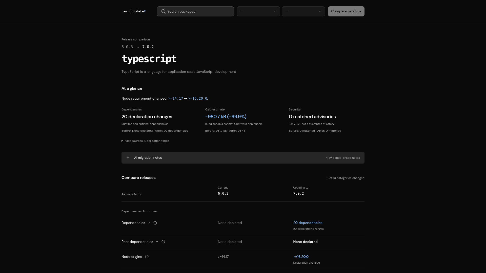

# Can I update?

> See important npm package changes before you update.

- [Check it out](https://caniupdate.dev)
- [Understand the results](docs/product/meaning-and-limitations.md)

Can I update? compares two versions of one public npm package in one view, so you do not have to search package metadata, release notes, and security databases separately.

## What you can compare

- **Dependencies and Node requirements** — See changes to required, optional, and peer dependencies and supported Node versions.
- **Package declarations** — Review import paths, module format, TypeScript settings, licenses, and install scripts.
- **Bundle estimates** — Compare Bundlephobia's estimates for the package on its own. Incomplete builds are clearly marked.
- **Security advisories** — Compare known issues found by OSV, a security advisory database, including gaps in its results.
- **AI notes with sources** — Read extra explanations based on the collected package data and maintainer notes.

Results arrive as they become available. Share a comparison link to the exact version pair, and use light or dark mode.

## What the results mean

This compares packages, not your application. It helps you review an update; it cannot tell you whether the update is safe for your project.

Bundle estimates are not your application's bundle size. Advisory results are not a security audit. AI notes can be wrong. Missing evidence means uncertainty, not “nothing changed.”

See [product meaning and limitations](docs/product/meaning-and-limitations.md) for the full guide.

## Contributing

Contributions are welcome! See [CONTRIBUTING.md](CONTRIBUTING.md) for guidance.

## License

Published under the [MIT License](LICENSE).
