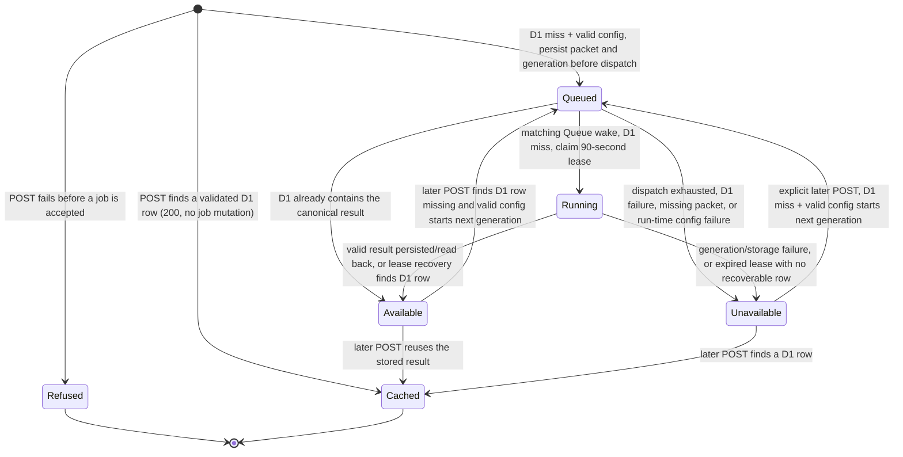

# Briefing architecture

A **briefing** is the supplementary AI notes for a comparison. This guide follows the evidence packet through generation, storage, and the browser's read-only connection. Jobs are durable: accepted work can continue after a viewer leaves.

The [comparison overview](overview.md) shows system ownership and the end-to-end sequence. [Evidence architecture](evidence.md) explains collection and caching. See [product meaning and limitations](../product/meaning-and-limitations.md) for what the notes mean.

## Evidence identity and private submission

For the reasons behind this design, see [evidence-based identity](adrs/briefing-evidence-identity.md) and [native RPC lifecycle handling](adrs/native-rpc-lifecycle.md).

The browser sends only a package name and two version selectors to Nuxt's `POST /api/package/{packageName}/compare/briefing` route. The [route](../../server/api/package/[packageName]/compare/briefing/index.post.ts) gets an evidence packet through the private binding and [evidence client](../../server/api/package/[packageName]/compare/_internals/evidenceClient.ts).

The route does not derive comparison facts, read D1, call the model, or accept a browser-supplied packet. The [packet builder](../../server/comparison/briefing/evidence/build.ts) packages comparisons already computed on the server, plus selected release/changelog material.

The [packer](../../server/comparison/briefing/evidence/packing.ts) selects sources by priority. It limits the packet to 48 KiB of UTF-8 and 64 sources, puts coverage last, and records omitted or truncated material as coverage and gaps. The shared schema checks the same byte limit and consecutive source numbers starting at 1. Changelog/release excerpts are capped at 4 KiB; coverage and gap detail is bounded too.

This evidence concerns the package itself. It is not the consumer application's dependency tree, a runtime test, or an actual application bundle measurement.

The [briefing service](../../workers/briefing/index.ts) strictly decodes the packet, then computes SHA-256 over `JSON.stringify` of that decoded packet. This **hash** identifies one `BriefingJob` Durable Object: a stateful Cloudflare service for that evidence snapshot.

The hash includes package/version identity, numbered sources, source text/URLs, gaps, and coverage—not just the version pair. It excludes retrieval time, model, provider key, and prompt. Matching packets can therefore reuse stored results across callers even after provider settings change. Evidence or packet changes can produce a new hash. The job decodes the packet again and refuses it if the recomputed hash differs from the object name.

`BriefingSubmitter.submit` uses private native RPC: one Worker calls another and receives an object, rather than JSON text. Its result contains public `submission` plus optional private `generationContext` for queued/running work. The public response contains only `submission`, never `generationContext`.

Object cleanup and strict validation differ between the built Worker and local Node development:

- workerd attaches an own `Symbol.dispose` cleanup hook to deserialized objects. The built Nuxt Worker requires it, captures it, and calls it in `finally`. Before strict decoding, Nuxt copies every own string-keyed property into a plain record and rejects other symbols or accessors.
- The private decoder rejects undeclared envelope fields and strictly decodes `submission`. Malformed optional trace context is dropped.
- Nuxt's Node development bridge hides symbol keys on Miniflare RPC proxies and omits their descriptor values. Only under Nuxt's compile-time development flag, Nuxt validates own data descriptors, reads live string-keyed values, and performs the same strict decode without a disposer. The built Worker removes that branch.

In the built runtime, an off-protocol object, missing/invalid disposer, or service rejection becomes sanitized 503. The route logs only an error name and, for the service's recognized error, a lowercase sanitized reason. It logs no packet contents, provider text, or credentials.

| Nuxt POST outcome                            | Meaning                                                                                                                                                                                                                                                                                                                                                                     |
| -------------------------------------------- | --------------------------------------------------------------------------------------------------------------------------------------------------------------------------------------------------------------------------------------------------------------------------------------------------------------------------------------------------------------------------- |
| `200` with `status: "available"`             | A validated D1 result exists for this packet hash. Returns the briefing; no socket needed.                                                                                                                                                                                                                                                                                  |
| `202` with `status: "queued"` or `"running"` | Accepts or joins a durable job. Returns hash, revision, and events URL. Queue delivery may advance the job before the response, leaving this record one revision behind. The socket's first snapshot is authoritative.                                                                                                                                                      |
| `503` refusal                                | Evidence/service binding or protocol failure, D1 read failure, missing/invalid provider settings on a cold hash, or a sanitized service error. Returns no submission envelope. Evidence binding failures use the route's evidence-unavailable response; other briefing refusals use its briefing-service response. Invalid route parameters are rejected before submission. |
| `429` refusal                                | General request limit before evidence collection, or separate new-generation limit at acceptance. `Retry-After: 60` and a fixed code distinguish them. No new job is accepted.                                                                                                                                                                                              |

Submission checks happen in this order:

1. Read D1, the permanent result store. A hit returns `200`, even if provider settings are now absent. A read failure is not a miss.
2. On a miss, require complete, valid provider configuration. Missing/invalid settings also prevent joining existing queued/running work.
3. Under the job's acceptance lock, reuse pending work, then recheck D1.
4. Only for a genuinely new generation, check `BRIEFING_GENERATION_LIMITER`.

Concurrent submitters with the same hash share one acceptance. Explicit retries after terminal failure count again. If configuration changes before an accepted job runs, that job settles unavailable with the configuration reason.

The private submit RPC also receives a strictly decoded temporary caller key from trusted Nuxt ingress. It never stores the key or includes it in public responses. See [request protection](overview.md#public-request-and-new-generation-protection).

The separate [`GET /api/package/{packageName}/compare/briefing` route](../../server/api/package/[packageName]/compare/briefing/index.get.ts) builds the same bounded packet, then calls [`BriefingSubmitter.read`](../../workers/briefing/index.ts). This RPC strictly decodes the packet and reads only the validated D1 success row for its hash.

The read RPC does not look up or change a `BriefingJob`, enqueue work, or require AI provider settings. The route returns strict `missing` or `available`. Evidence, D1, and protocol failures return sanitized `503`, never `missing`.

Server-side rendering (SSR) uses this route to fill the existing briefing query only when a result is available. It never invokes the POST query function or starts generation. Rebuilding the packet can still collect evidence; the read RPC itself is D1-only.

## Trace correlation and diagnostics

Diagnostics link browser requests to shared work without exposing private inputs. A **span** records one timed operation; a **trace** connects related spans. A span link can connect otherwise independent traces.

The [comparison page](../../app/pages/[packageName]/[versionPair].vue) creates a `comparison.page` root for each client-side route entry. Each POST attempt from the [briefing query](../../app/composables/packageBriefingQueryOptions.ts) creates a separate `briefing.submit` client span and sends only its W3C `traceparent`.

A valid version-00 header makes Nuxt's `briefing.submit` server span its direct child. Missing, malformed, or unsupported headers start a new server trace, not a rejected request. The parser accepts only the exact 55-character lowercase version-00 form with nonzero trace/span IDs. Inbound flags do not control local sampling. `baggage` and `tracestate` are not read.

When the service accepts or joins queued/running work, it returns the job's independent `generationContext` only to the [Nuxt route](../../server/api/package/[packageName]/compare/briefing/index.post.ts). The route links each submit/join server span to that generation root. The browser still receives only public `submission`.

The DO's [trace helper](../../workers/briefing/jobTrace.ts) saves optional `JobRecord.traceContext` under the job lock. Same-hash callers share it. Older pending records can acquire context on join or lease claim. After Queue delivery or restart, the later `briefing.generation` span uses it as parent.

Trace storage is diagnostic, not a condition for work:

- Failed attachment to an existing pending job is ignored.
- New acceptance retries its required write without context.
- Required lease/state-transition writes still fail normally.
- Terminal records discard context with the packet. Queue messages remain `{ hash, generationId }`.

Effect JSON console records include correlation IDs and safe parent/link fields. Examples are `comparison.page.opened`, `briefing.submission.started`, `briefing.submission.accepted`, `briefing.generation.accepted`, and `briefing.generation.started`. Optional OTLP export sends these logs and completed spans for the chosen Grafana resource. Console output remains authoritative locally.

Identity and privacy rules are:

- `comparison.package.name` contains validated identity. `comparison.version.from` / `comparison.version.to` appear only after registry resolution.
- The page root carries operation context only. Client submission records use resolved query identity.
- Nuxt derives identity from the trusted packet before service I/O. Failures before a packet exists carry no input identity.
- Acceptance, older-record trace attachment, and execution derive identity from their own persisted packet. Restarts need no extra diagnostic storage or Queue fields.
- Known evidence failure categories and missing-service-binding names may be exported, not raw error text.
- Context goes to neither package/AI providers nor WebSocket URLs/frames. Annotations exclude evidence, prompts, credentials, raw provider errors, full URLs, and job hashes.

`briefing.job.settled` is emitted only after the terminal DO write succeeds. Before discarding the packet/context, it takes resolved public identity and the generation link from the prior pending record. Reading a terminal record again does not emit another settlement.

`settlement` distinguishes generation, persisted-result recovery, expired lease, provider failure, configuration refusal, storage failure, and dispatch exhaustion. `outcome`, fixed `reason`, and decimal-string `revision` record the result without error prose. A failed terminal write emits a `briefing.job.recovery` storage-write failure and rethrows the original error. It never claims settlement.

Other decision records explain the path:

- `briefing.dispatch.decision`: fixed submission/alarm trigger, bounded attempt, and send/retry/exhaustion decision.
- `briefing.queue.decision`: acknowledgment versus retry, and malformed/stale/duplicate work. No Queue bodies or hashes.
- `briefing.job.recovery`: meaningful lease/reconciliation decisions. Alarm `hit`, `miss`, and `failure` describe the D1 lookup at the recorded revision. They do not claim the alarm won terminal settlement; only `briefing.job.settled` records its durable cause.

The Worker-local [state/protocol model](../../workers/briefing/jobState.ts) constructs records/envelopes. [Dispatch ownership](../../workers/briefing/jobDispatch.ts) separates synchronized bookkeeping from sending.

Diagnostics are best effort. No network flush is awaited while the job lock is held. Logging cannot change Queue acknowledgments or provider-call counts. Filter console/OTLP by `linkedTraceId` to connect these records to the independent generation root and its submitters.

## Durable job lifecycle and recovery

The [durable ownership decision](adrs/durable-briefing-ownership.md) explains why work continues after a viewer leaves, and why uncertain provider outcomes do not automatically trigger another paid call.

Each hash has one SQLite-backed DO record. Queued/running records retain the immutable, bounded packet. Queue messages contain only `{ hash, generationId }`, never evidence, prompts, or credentials.

A lock serializes acceptance, lease claims, and terminal commits. The network generation call runs outside the lock. Generation IDs reject old Queue messages. Revisions increase so the browser can discard stale snapshots.

Creating a generation, claiming `running`, and committing a terminal state each advance the revision. Dispatch-attempt bookkeeping does not.

`Refused` and `Cached` are response paths in the diagram, not stored states. Stored jobs are either pending (`queued`, `running`) or terminal (`available`, `unavailable`).

A failed job stays terminal until an explicit later POST. If D1 has no result and configuration is valid, that POST starts a new generation and increments its generation ID and revision. Old Queue messages then fail the generation check. A terminal unavailable event does not make the browser resubmit automatically.

An explicit POST can also restart an `available` job if its D1 row has disappeared and configuration is valid. Acceptance reuses only pending records. This can incur another provider charge. A read-only socket cannot recover the missing row this way; it errors instead.

Before acknowledging acceptance, the submitter saves the queued record and packet. It arms a 30-second dispatch-recovery alarm, then tries to send the Queue pointer. The alarm re-dispatches queued work. After at most three dispatch attempts, the job becomes unavailable with `provider-error`.

Queue delivery may be duplicated. Wrong-hash/generation messages, or messages for jobs no longer queued, do not call the provider. They return the current reconciled snapshot. The Queue handler acknowledges successfully handled or malformed messages; unexpected job errors request Queue retry.

A matching queued delivery checks D1 before any provider call:

1. A hit commits/reports the canonical result without generation. A read error settles `cache-error`.
2. On a miss, the packet must still exist and configuration must still be valid.
3. The job claims `running`, records a fencing token (protection against stale writers), and sets a 90-second lease alarm: 75 seconds for generation plus 15 seconds for persistence.
4. The provider call runs outside the job lock.

An early lease alarm is reset to the lease expiry. After expiry, it checks D1 first. A stored row proves completion and is committed as available. A missing row settles `timeout`; an unreadable/corrupt row settles `cache-error`. Lease recovery never automatically buys another provider call.

Terminal commits discard the packet, clear the alarm, and preserve the first terminal writer. They notify accepted subscribers once, then close their sockets normally.

## Result storage and generation failures

D1 is the authoritative source for available briefing content. The [store](../../server/comparison/briefing/store.ts) validates the available response, batches `INSERT ... ON CONFLICT DO NOTHING` with a select, and returns the selected row.

Concurrent writers for one hash therefore use the first stored validated success; they do not overwrite it. A write counts as success only after the row is read back.

The [typed schema](../../shared/db/briefingSchema.ts) keys rows by evidence hash. [Generated migrations](../../migrations/) preserve text JSON/timestamps, explicit nullability, and SQLite's timestamp default. Drizzle supplies the typed D1 insert/select batch. Effect Schema validation and tagged read/write/corruption failures stay separate.

The DO keeps terminal state and revision, not another canonical briefing copy. Available snapshots read D1 again.

These ordering rules keep different failures distinct:

- Submission-side D1 read failure returns `503 cache-error` before accepting a job. Only a read miss continues to configuration and acceptance.
- Queue-side D1 read failure settles unavailable `cache-error` without calling the provider. Corrupt JSON/schema is a store failure, not a miss.
- D1 write/read-back failure after generation settles `cache-error`. The provider call may already be paid, but the job cannot report durable availability.
- Lease recovery treats a missing row as `timeout`, but a failed read as `cache-error`. A row written before a crash is served without another call.
- An available socket snapshot must read D1. A transient read failure throws; an accepted socket closes with `1011`. If the row disappeared, job storage cannot reconstruct it. The current terminal-event path also errors on a missing available row instead of replacing the first terminal state.

The [provider boundary](../../server/comparison/briefing/provider.ts) requires endpoint, key, and model settings. Absent configuration maps to `not-configured`; partial or unsupported settings map to `invalid-config`.

HTTPS endpoints are allowed. Plain HTTP is allowed only on loopback. The endpoint must name the OpenAI-compatible `/chat/completions` route, with no query parameters, credentials, or fragment. Redirects are rejected so bearer keys cannot be forwarded to another origin.

A generation requests a JSON object with one to five bullets. The [decoder](../../server/comparison/briefing/generation.ts) and [prompt contract](../../server/comparison/briefing/prompt.ts) require:

- Exact object keys.
- `change`/`migration` kinds and `fact`/`maintainer`/`inference` bases.
- Nonblank prose, at most 600 Unicode characters.
- One to eight unique citations, all present in the packet.

Inline URLs/URI schemes, generated coverage bullets, missing citations, malformed JSON, and non-`stop` output are invalid. The response body is limited to 128 KiB while reading. Valid results retain cited sources plus coverage and renumber them from zero for display. Rejected text is not sent back to the model.

Invalid output gets one fresh attempt using the same packet and prompt. One 75-second deadline covers both attempts, reading, and decoding:

- Second invalid result: `invalid-response`.
- HTTP/provider failure: `provider-error`, with no invalid-output retry.
- Deadline expiry: `timeout`.

The full set of generated unavailable reasons is `not-configured`, `invalid-config`, `provider-error`, `cache-error`, `timeout`, and `invalid-response`.

External billing is not exactly-once. After a timeout or process loss, the application may not know whether the provider accepted or billed the request.

A crash after a D1 write is recovered without another call. A crashed run with no row times out without automatic regeneration. A later explicit POST can still start a new generation and spend again. A write refusal can likewise follow a paid call, and a later POST can retry.

Same-hash callers share active work and reuse stored success while its D1 row exists. These are local duplicate-spend controls, not a fixed budget or a promise of one lifetime inference per version pair. A changed packet has a different hash; a terminal failed hash can be retried explicitly.

Any OpenRouter budget is a separate external provider cap. The application has no account-wide budget ledger.

## Public socket and browser follower

The public Worker in [`workers/briefing/index.ts`](../../workers/briefing/index.ts) serves only `GET /api/briefings/{64 lowercase hex}/events` as a WebSocket upgrade. A WebSocket keeps a connection open so the server can send job updates.

Request rules are:

- `POST`: `405`.
- Malformed path or unknown job: `404`.
- Matching path without an upgrade: `426`.
- Missing or unapproved Origin: `403`.

`BRIEFING_ALLOWED_ORIGIN` is a comma-separated list. Whitespace is trimmed, then each origin is compared byte-for-byte. An empty/unset list allows none. This gate controls browser origins, not user/session authorization.

The path can read only the named job. It cannot create jobs, enqueue work, generate, or read the evidence packet.

The DO accepts upgrades only for existing jobs and uses Cloudflare's hibernating WebSocket API. On connect, it takes a lock-protected snapshot and sends the current queued/running revision or a terminal event. Available content comes from D1.

Inbound messages do nothing. There are no socket commands for retry, cancellation, or submission. Terminal commits send one terminal frame per open subscriber, then close normally with `1000`. If an accepted socket cannot get its initial snapshot, it closes with `1011`. Subscribing or reconnecting creates no Queue/provider work.

The private service builds `eventsUrl` from `BRIEFING_PUBLIC_URL`, the hash, and `/api/briefings/{hash}/events`. For local/LAN access, Nuxt's [`browserBriefingSocketUrl`](../../server/api/package/[packageName]/compare/briefing/_internals/socketUrl.ts) makes loopback advertisements (`localhost`, `127.*`, or `::1`) reachable from the page's host.

It prefers the request Origin's hostname, then Host, and changes only the socket hostname. The advertised WebSocket scheme, port, and path/hash stay unchanged. Without a usable host, it keeps the advertised URL. Non-loopback deployed service hostnames are untouched. This rewrite is separate from the public Worker's Origin allowlist.

The [browser query](../../app/composables/packageBriefingQueryOptions.ts) uses trimmed package/from/to as its key. On a cache miss, its client function submits one POST with query-level retries disabled. SSR may fill the same key from a validated D1 success, but never invokes that function.

After a sanitized `503`, the client waits 250 ms and makes exactly one more POST. Other errors surface immediately; a second refusal ends the query. This narrow retry can rejoin the same hash-addressed job after an ambiguous response. A `200` needs no socket. A `202` publishes the initial queued/running state and follows its socket URL.

A `429` never resubmits automatically. The notes panel distinguishes new-generation exhaustion from general request exhaustion and offers manual retry. Successful facts remain usable. Remount and network reconnect do not automatically retry failed comparison queries.

The provider's bounded invalid-output retry is still part of one accepted generation. It does not consume a second acceptance allowance.

The browser strictly decodes socket frames. It starts with the submission's revision and ignores any frame at or below the highest seen revision, including delayed frames from earlier connections.

New queued/running revisions update visible status. An available frame returns the briefing. An unavailable frame returns an unavailable briefing without removing factual comparison data. Invalid frames fail the query rather than being ignored.

If a connection closes before a terminal frame, the browser reconnects to the same URL after 1, 2, then 4 seconds: at most three reconnects and four connections total. Reconnect never resubmits a POST. One 180-second deadline covers connections, backoff, and progress frames. Exhaustion or a fourth disconnect fails the query.

Vue Query's abort signal cancels the pending 250 ms pause or active subscription, closes the socket, and interrupts reconnect backoff. The [composable](../../app/composables/useComparisonBriefing.ts) clears the previous comparison's status when the key changes.

This cancels only that browser's wait. There is no server cancel endpoint or client-frame command. After navigation/unmount, accepted shared work continues for other callers and durable recovery.

## Source and behavior references

- [Worker entrypoints and job state](../../workers/briefing/index.ts), [job implementation](../../workers/briefing/job.ts), and [exact Origin parsing](../../workers/briefing/allowedOrigins.ts).
- [Nuxt submission route](../../server/api/package/[packageName]/compare/briefing/index.post.ts), [socket URL rewriting](../../server/api/package/[packageName]/compare/briefing/_internals/socketUrl.ts), and [strict public protocol](../../shared/comparison/briefing/briefingJob.defs.ts).
- [Packet construction](../../server/comparison/briefing/evidence/build.ts), [packet admission](../../server/comparison/briefing/evidence/packing.ts), and [store](../../server/comparison/briefing/store.ts).
- [Job integration tests](../../workers/briefing/jobs.unit), [public socket tests](../../workers/briefing/sockets.unit), [Origin tests](../../workers/briefing/allowedOrigins.unit.ts), [Nuxt route tests](../../server/api/package/[packageName]/compare/briefing/index.post.unit.ts), [hash/generation tests](../../server/comparison/briefing/generation.unit.ts), [store tests](../../server/comparison/briefing/store.unit.ts), [socket URL tests](../../server/api/package/[packageName]/compare/briefing/_internals/socketUrl.unit.ts), and [browser lifecycle tests](../../app/composables/packageBriefingQueryOptions.unit.ts).
