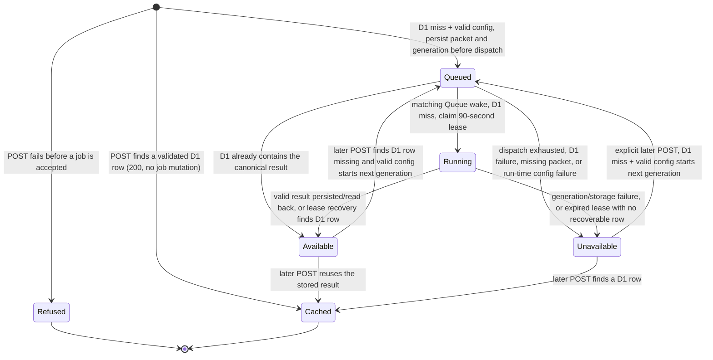

# Briefing architecture

[Comparison overview](overview.md) owns the system-level ownership diagram and end-to-end comparison sequence. [Evidence architecture](evidence.md) owns backend collection and evidence-cache behavior. This document follows the separate briefing path from its bounded packet to a durable result and the browser's read-only subscription. The product's intended meaning and limits are in [product meaning and limitations](../product/meaning-and-limitations.md).

## Evidence identity and private submission

Decision rationale: [evidence-based identity](adrs/briefing-evidence-identity.md) and [native RPC lifecycle handling](adrs/native-rpc-lifecycle.md).

The browser submits only a package name and two version selectors to the Nuxt `POST /api/package/{packageName}/compare/briefing` route. The [route](../../server/api/package/[packageName]/compare/briefing/index.post.ts) obtains the packet from the private evidence binding through the [evidence client](../../server/api/package/[packageName]/compare/_internals/evidenceClient.ts); it does not derive comparison facts, read D1, call the model, or accept a packet from the browser. The [packet builder](../../server/comparison/briefing/evidence/build.ts) packages already-computed comparisons and selected release/changelog material. Its [packer](../../server/comparison/briefing/evidence/packing.ts) admits sources by priority within a 48 KiB UTF-8 / 64-source bound, places coverage last, and records omissions and truncated prose as coverage and gaps. The shared packet schema checks the same byte limit and contiguous 1-based source numbers. Changelog/release excerpts are capped at 4 KiB; coverage and gap detail is bounded too. This remains direct-package evidence, not the consumer application's dependency tree, a runtime test, or an actual application bundle measurement.

The [briefing service](../../workers/briefing/index.ts) strictly decodes that packet, derives its own SHA-256 over `JSON.stringify` of the decoded packet, and addresses one `BriefingJob` Durable Object by that hash. The hash covers package/version identity, numbered sources, their text/URLs, gaps, and coverage material—not just a package/version pair. Retrieval time, model, provider key, and prompt are not inputs, so a matching packet can reuse its stored result across callers even if provider settings change. Any evidence or packet change can produce a distinct hash. The job re-decodes the packet and refuses it if the recomputed hash does not match the object name.

The binding-facing `BriefingSubmitter.submit` returns a private **native RPC object** containing the public `submission` and optional `generationContext` for a queued or running job. workerd attaches an own `Symbol.dispose` lifecycle hook to deserialized objects. In the built Worker, Nuxt requires that documented hook, captures it, and invokes it in `finally`; before strict decoding, it copies every own string-keyed property into a plain record and rejects any other symbol or accessor. The private result decoder rejects undeclared envelope fields and strictly decodes `submission`; malformed optional trace context is dropped. Nuxt's Node development bridge intentionally hides all symbol keys on Miniflare RPC proxies and omits their descriptor values, so only under Nuxt's compile-time development flag it validates own data descriptors, reads the live string-keyed values, and performs the same strict decode without a disposer; the built Worker folds that branch away. The public response contains only `submission`, never `generationContext`. A built-runtime off-protocol object, missing/invalid disposer, or service rejection becomes a sanitized 503. The route logs only an error name and, for the service's recognized error, a lowercase sanitized reason—not packet contents, provider text, or credentials.

| Nuxt POST outcome                            | Meaning                                                                                                                                                                                                                                                                                                                                                                                 |
| -------------------------------------------- | --------------------------------------------------------------------------------------------------------------------------------------------------------------------------------------------------------------------------------------------------------------------------------------------------------------------------------------------------------------------------------------- |
| `200` with `status: "available"`             | A validated D1 result already exists for this packet hash. The response contains the briefing and does not need a socket.                                                                                                                                                                                                                                                               |
| `202` with `status: "queued"` or `"running"` | The service accepted or joined a durable job and returned its hash, revision, and events URL. The submitted record can be one revision behind if a queue delivery advances the job before the response is sent; the socket's first snapshot is authoritative.                                                                                                                           |
| `503` refusal                                | Evidence/service binding or protocol failure, D1 read failure, invalid or missing provider configuration on a cold hash, or a sanitized service error. No submission envelope is returned. Evidence binding failures use the route's evidence-unavailable response; other briefing refusals use its briefing-service response. Invalid route parameters are rejected before submission. |
| `429` refusal                                | General request protection before evidence collection, or the separate new-generation allowance at job acceptance. `Retry-After: 60` and a fixed code distinguish them. No new job is accepted on refusal.                                                                                                                                                                              |

A cold submission reads D1 before configuration and before accepting a job. A D1 hit returns `200` even if provider configuration is now absent. A D1 read failure is not treated as a miss. On a miss, configuration must be complete and valid before the object checks whether a queued/running job can be reused; consequently a missing/invalid configuration also prevents a new submission from joining an existing pending job. If an accepted job later runs after its configuration has changed, it settles unavailable with that configuration reason.

After a D1 miss and valid configuration, the job's acceptance lock first reuses pending work, then rechecks D1 before calling `BRIEFING_GENERATION_LIMITER`. Only a genuinely new generation consumes this allowance. Concurrent same-hash submitters share one acceptance; explicit retries after a terminal failure count again. The private submit RPC additionally receives a strictly decoded transient caller key from trusted Nuxt ingress. It never stores that key or includes it in public responses. See [request protection](overview.md#public-request-and-new-generation-protection).

The separate [`GET /api/package/{packageName}/compare/briefing` route](../../server/api/package/[packageName]/compare/briefing/index.get.ts) builds the same bounded packet through the private evidence binding, then calls [`BriefingSubmitter.read`](../../workers/briefing/index.ts). That RPC strictly decodes the packet and reads only the validated D1 success row for its evidence hash; it does not look up a `BriefingJob`, mutate job state, enqueue, or require AI provider settings. The route returns a strict `missing` or `available` result; evidence, D1, and protocol failures remain sanitized `503` errors, never misses. SSR uses this route to hydrate the existing briefing query only for an available result. It never invokes the POST query function or starts generation. Rebuilding the packet may still involve normal evidence collection; the read RPC itself is D1-only.

## Trace correlation and diagnostics

The [comparison page](../../app/pages/[packageName]/[versionPair].vue) creates a `comparison.page` root for each client-side route entry. Every POST attempt from the [briefing query](../../app/composables/packageBriefingQueryOptions.ts) creates a distinct `briefing.submit` client span and sends only its W3C `traceparent`; a valid version-00 header makes the Nuxt route's `briefing.submit` server span its direct child. Missing, malformed, or unsupported headers start a fresh server trace rather than rejecting the application request. The parser accepts only the exact 55-character lowercase version-00 form with nonzero trace/span IDs; the inbound flags do not control local sampling. `baggage` and `tracestate` are not read.

When the private service accepts or joins a queued/running job, it returns that job's independent `generationContext` only to the [Nuxt route](../../server/api/package/[packageName]/compare/briefing/index.post.ts). The route adds a span link from each submit/join server span to the same generation root and returns only the existing public `submission`. The Durable Object's [trace helper](../../workers/briefing/jobTrace.ts) persists optional `JobRecord.traceContext` under its job lock; same-hash callers share it, legacy pending records can acquire one on join or lease claim, and the later `briefing.generation` span uses it as parent after Queue delivery or restart. Context persistence is diagnostic: a failed attachment to an existing pending job is ignored; a new acceptance retries its required write without context. Required lease/state-transition writes still fail normally. Terminal records discard it with the packet. The Queue message remains `{ hash, generationId }`.

Correlation IDs and safe parent/link fields appear in Effect JSON console records such as `comparison.page.opened`, `briefing.submission.started`, `briefing.submission.accepted`, `briefing.generation.accepted`, and `briefing.generation.started`. Optional OTLP export retains those logs and completed spans for the chosen Grafana resource; console output stays authoritative locally. Records include validated `comparison.package.name`; `comparison.version.from` / `comparison.version.to` appear only after registry resolution. The page root carries operation context only, and its client submission records use resolved query identity. Nuxt derives identity from the trusted packet before service I/O; failures before a packet exists carry no input identity. Generation acceptance, legacy trace attachment, and execution derive identity from their own persisted packet, so restarts require no extra diagnostic storage or Queue fields. Known evidence failure categories and missing-service-binding names remain exportable, not raw error text. Context is not sent to package/AI providers or WebSocket URLs/frames; annotations contain no evidence, prompts, credentials, raw provider errors, full URLs, or job hashes.

`briefing.job.settled` is emitted only after the terminal Durable Object put succeeds. It snapshots resolved public identity and the generation link from the prior pending record before the packet/context are discarded; repeated terminal reads do not emit a new settlement. `settlement` distinguishes generation, persisted-result recovery, expired lease, provider failure, configuration refusal, storage failure, and dispatch exhaustion. `outcome`, fixed `reason`, and decimal-string `revision` retain the result without error prose. A failed terminal put emits a `briefing.job.recovery` storage-write failure and rethrows the original failure; it never claims settlement.

`briefing.dispatch.decision` records the fixed submission/alarm trigger, bounded attempt and send/retry/exhaustion decision. `briefing.queue.decision` distinguishes ack from retry and malformed/stale/duplicate work, without Queue bodies or hashes. `briefing.job.recovery` records meaningful lease/reconciliation decisions. Alarm `hit`, `miss`, and `failure` describe the observed D1 lookup against the recorded revision, not a claim that the alarm won terminal settlement; only `briefing.job.settled` carries the durable settlement cause. The worker-local [state/protocol model](../../workers/briefing/jobState.ts) owns record/envelope construction, and [dispatch ownership](../../workers/briefing/jobDispatch.ts) keeps synchronized bookkeeping separate from sending. These are best-effort emissions; no network flushing is awaited while the job lock is held, and logging cannot change Queue acknowledgments or provider-call counts. Filter console/OTLP by `linkedTraceId` to join these records to the independent generation root and its submitters.

## Durable job lifecycle and recovery

The [durable ownership decision](adrs/durable-briefing-ownership.md) explains why accepted work outlives its viewer and uncertain provider outcomes do not automatically regenerate.

Each hash has one SQLite-backed Durable Object record. While queued or running it retains the immutable bounded packet; the Queue message contains only `{ hash, generationId }`, never evidence, prompt, or provider credentials. The object serializes acceptance, lease claims, and terminal commits with a lock, while keeping the network generation call outside the lock. A generation ID rejects stale queue messages; a monotonically increasing revision lets the browser discard stale snapshots. Creating a generation, claiming `running`, and committing a terminal state each advance the revision; dispatch-attempt bookkeeping does not.

`Refused` and `Cached` in the diagram are response paths, not persisted job states. A job's terminal states are `available` and `unavailable`; its pending states are `queued` and `running`. A failed job stays terminal until an explicit later POST. If no D1 result exists and configuration is valid, that POST creates a new generation with an incremented generation ID and revision; old Queue messages then fail the generation check. The browser does not automatically resubmit just because it receives a terminal unavailable event. An `available` job can also start a new generation on an explicit POST if its D1 row has disappeared and configuration is valid: acceptance reuses only pending records. This may incur another provider charge. A read-only socket cannot perform that recovery and instead errors when the stored available result is missing.

The submitter persists the queued record and packet before acknowledging acceptance. It arms a 30-second dispatch-recovery alarm before attempting to send the Queue pointer. The alarm re-dispatches a queued job; at most three dispatch attempts are made, after which the job becomes unavailable with `provider-error`. Queue deliveries can be duplicated: a message for the wrong hash/generation or a job no longer queued does not call the provider and instead returns the current reconciled snapshot. The Queue handler acknowledges a successfully handled or malformed message; an unexpected job error requests Queue retry.

A matching queued delivery reads D1 before any provider call. A D1 hit commits/reports the canonical result without generation; a read error settles `cache-error`. On a miss, the packet must still be present and configuration must still be valid before the job claims `running`. Claiming records a fencing token and a 90-second lease alarm (75 seconds for generation plus a 15-second persistence margin). The provider call is outside the job lock. On lease alarm, an early alarm is reset to the lease expiry; after expiry, D1 is checked first. A stored row proves the job finished and is committed as available; a missing row settles `timeout`; an unreadable/corrupt row settles `cache-error`. Lease recovery does not automatically buy another provider call. Terminal commits drop the packet, clear the alarm, preserve the first terminal writer, notify accepted subscribers once, and close them normally.

## Result storage and generation failures

D1 is the authority for available briefing content. The [store](../../server/comparison/briefing/store.ts) validates an available response, batches an `INSERT ... ON CONFLICT DO NOTHING` with a select, and returns the selected row. Thus concurrent writers for one hash converge on the first stored validated success rather than overwrite it. A write is not success until the row can be read back. The [typed schema](../../shared/db/briefingSchema.ts) keys rows by evidence hash; [generated migrations](../../migrations/) preserve text JSON/timestamps, explicit nullability and the SQLite timestamp default. Drizzle supplies the typed D1 insert/select batch; Effect Schema validation and tagged read/write/corruption failures remain independent. The Durable Object keeps terminal state/revision, not a second canonical copy of the briefing; available snapshots read D1 again.

These ordering choices keep distinct failures distinct:

- A submission-side D1 read error returns `503 cache-error` before a job is accepted. A read miss is the only path onward to configuration and acceptance.
- A queue-side D1 read error settles the job as unavailable `cache-error` without calling the provider. Corrupt JSON/schema is a store failure, not a cache miss.
- A D1 write/read-back failure after generation settles `cache-error`; the provider call may already have been paid, but the job cannot report durable availability.
- Lease reconciliation separates an absent row (`timeout`) from a failed read (`cache-error`). If a row was written before a crash, reconciliation serves it without another call.
- A socket snapshot for an available record must read its D1 row. A transient read failure throws rather than inventing or erasing a result; the Durable Object closes an accepted socket with `1011`. A terminal available record whose row has disappeared cannot be reconstructed from job storage. The current terminal-event path also treats a missing available row as an error rather than replacing the first terminal state.

The [provider boundary](../../server/comparison/briefing/provider.ts) requires a complete endpoint/key/model configuration. An absent configuration maps to `not-configured`; partial or unsupported configuration maps to `invalid-config`. HTTPS endpoints are permitted; plain HTTP is restricted to loopback. The configured endpoint must identify the OpenAI-compatible `/chat/completions` route without query parameters, credentials, or a fragment. Redirects are not followed so a bearer key is not forwarded to another origin.

A generation asks for a JSON object containing one to five bullets. The [decoder](../../server/comparison/briefing/generation.ts) and [prompt contract](../../server/comparison/briefing/prompt.ts) require exact object keys, allowed `change`/`migration` kinds and `fact`/`maintainer`/`inference` bases, nonblank prose of at most 600 Unicode characters, and one to eight unique citations that exist in the packet. Inline URLs/URI schemes, generated coverage bullets, missing citations, malformed JSON, and non-`stop` output are invalid. The output body is capped at 128 KiB while reading. Valid responses retain cited sources plus coverage and renumber them from zero for display; rejected text is not fed back to the model.

Invalid model output gets one fresh generation attempt with the same packet and prompt. The 75-second deadline covers both attempts, body reading, and decoding. A second invalid result maps to `invalid-response`; an HTTP/provider failure maps to `provider-error` without an invalid-output retry; deadline expiry maps to `timeout`. The generated unavailable reasons are `not-configured`, `invalid-config`, `provider-error`, `cache-error`, `timeout`, and `invalid-response`.

There is no exactly-once billing guarantee for the external call. A timeout or process loss can leave it unknown whether the provider accepted or billed a request. A crash after a D1 write is reconciled without another call; a crashed run with no row is timed out without automatic regeneration, but a later explicit POST can start another generation and may spend again. Likewise, a write refusal can happen after a paid call, and a later POST can retry. Hash coalescing and the current D1 row are local duplicate-spend controls across callers: they avoid separate calls for the same active job and reuse its stored success while that row exists. They are not a fixed monetary cap or a promise of one lifetime inference per version pair. A changed packet has a different hash, and a terminal failed hash can be explicitly retried. Any OpenRouter budget is a separate external provider cap; the application has no account-wide budget ledger.

## Public socket and browser follower

The public Worker surface in [`workers/briefing/index.ts`](../../workers/briefing/index.ts) serves only `GET /api/briefings/{64 lowercase hex}/events` as a WebSocket upgrade. `POST` is refused with `405`; a malformed path or unknown job is `404`; a matching path without an upgrade is `426`; an absent or non-allow-listed Origin is `403`. `BRIEFING_ALLOWED_ORIGIN` is a comma-separated, whitespace-trimmed list compared byte-for-byte; an empty/unset list allows none. It is an Origin gate for browser subscriptions, not a user/session authorization mechanism. The path can read only the named job, and it cannot create a job, enqueue, generate, or read the evidence packet.

A Durable Object socket accepts only an upgrade for an existing job. It uses the hibernating WebSocket API, takes a lock-protected snapshot on connect, and sends the current queued/running revision or a terminal event. Available data is read from D1. Inbound client messages are inert; there is no socket command for retry, cancellation, or submission. Terminal commits send one terminal frame to each open subscriber and close normally with code `1000`; an accepted socket that cannot obtain its initial snapshot closes with `1011`. Socket subscription and reconnect do not create Queue or provider work.

The private service builds `eventsUrl` from `BRIEFING_PUBLIC_URL`, the hash, and `/api/briefings/{hash}/events`. The Nuxt route uses [`browserBriefingSocketUrl`](../../server/api/package/[packageName]/compare/briefing/_internals/socketUrl.ts) to make a loopback advertisement (`localhost`, `127.*`, or `::1`) reachable from the page's host: it prefers the request Origin's hostname, falls back to Host, and changes only the socket URL's hostname. The advertised WebSocket scheme, port, and path/hash remain in place. If no usable host is supplied, it keeps the advertised URL; a non-loopback deployed service hostname is returned untouched. This re-pointing is for local/LAN access and is separate from the public Worker Origin allow-list.

The [browser query](../../app/composables/packageBriefingQueryOptions.ts) is keyed by trimmed package/from/to. On a cache miss, its client query function submits one POST with query-level retries disabled; SSR may seed the same key from a validated D1 success but never invokes the query function. It makes exactly one additional POST after a sanitized `503`, waiting 250 ms; other errors are surfaced, and a second refusal ends the query. This narrow retry can rejoin the same hash-addressed job if the first response was ambiguous. An immediate `200` needs no socket. A `202` publishes its initial queued/running state and follows the supplied socket URL.

A `429` is never automatically resubmitted. The notes panel distinguishes new-generation exhaustion from general request exhaustion and offers a manual retry. Successful facts remain usable. Remount and network reconnect do not automatically retry failed comparison queries. The provider's bounded invalid-output retry remains part of one accepted generation, not a second acceptance allowance.

The browser strictly decodes frames, initializes its highest seen revision from the submission, and ignores frames at or below that revision (including delayed frames from an earlier connection). New queued/running revisions update the visible status. An available frame returns the briefing; an unavailable frame becomes an unavailable briefing while factual comparison data remains usable. Invalid frames fail the query rather than being silently ignored. If a socket closes without a terminal frame, the client reconnects to the same URL after 1, 2, then 4 seconds—at most three reconnects and four connections total—and never resubmits merely to reconnect. One 180-second deadline spans connection attempts, backoff, and progress frames; exhaustion or a fourth disconnect fails the query.

Vue Query's abort signal cancels the pending 250 ms submission pause or the active subscription, closes the current socket, and interrupts backoff; the [composable](../../app/composables/useComparisonBriefing.ts) clears the prior comparison's status when the key changes. This cancels only that browser's wait. There is no server-side cancel endpoint or client-frame command, so accepted shared job work continues after navigation/unmount for other callers and for durable recovery.

## Source and behavior references

- [Worker entrypoints and job state](../../workers/briefing/index.ts), [job implementation](../../workers/briefing/job.ts), and [exact Origin parsing](../../workers/briefing/allowedOrigins.ts).
- [Nuxt submission route](../../server/api/package/[packageName]/compare/briefing/index.post.ts), [socket URL rewriting](../../server/api/package/[packageName]/compare/briefing/_internals/socketUrl.ts), and [strict public protocol](../../shared/comparison/briefing/briefingJob.defs.ts).
- [Packet construction](../../server/comparison/briefing/evidence/build.ts), [packet admission](../../server/comparison/briefing/evidence/packing.ts), and [store](../../server/comparison/briefing/store.ts).
- [Job integration tests](../../workers/briefing/jobs.unit), [public socket tests](../../workers/briefing/sockets.unit), [Origin tests](../../workers/briefing/allowedOrigins.unit.ts), [Nuxt route tests](../../server/api/package/[packageName]/compare/briefing/index.post.unit.ts), [hash/generation tests](../../server/comparison/briefing/generation.unit.ts), [store tests](../../server/comparison/briefing/store.unit.ts), [socket URL tests](../../server/api/package/[packageName]/compare/briefing/_internals/socketUrl.unit.ts), and [browser lifecycle tests](../../app/composables/packageBriefingQueryOptions.unit.ts).
