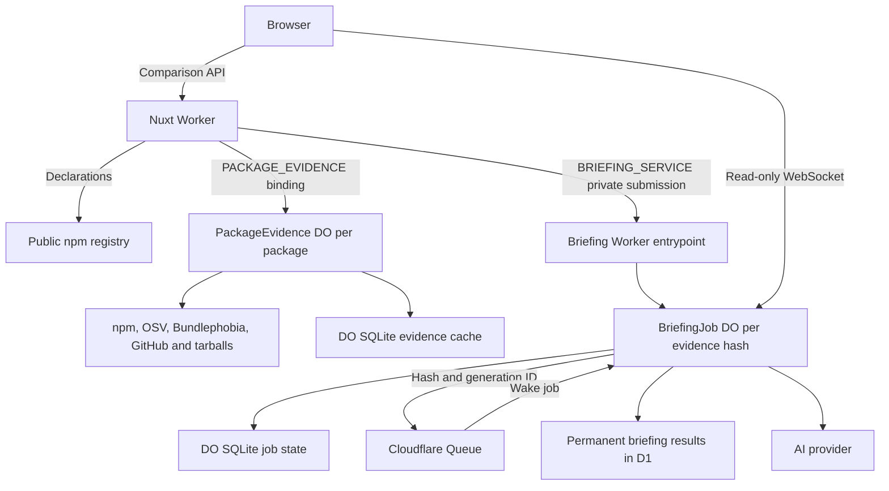

# Comparison architecture

The system compares two versions of one public npm package. It shows package declarations first, then measurements and supplementary AI notes. It does not assess a consumer project or approve an upgrade. See [product meaning and limitations](../product/meaning-and-limitations.md).

**Declarations** are what the package says in its registry manifest, such as dependencies and supported Node versions. **Measurements** add evidence from external providers and the package archive. A **briefing** adds AI notes; it never replaces those facts.

This guide describes the current source code, not what is running in a deployed environment. [Evidence architecture](evidence.md) explains how evidence is collected, cached, and limited, including provider failures. [Briefing architecture](briefing.md) explains how AI notes are generated, saved, and followed by the browser.

## Shared module organization

`shared/` holds contracts and helpers used across runtimes. Its main groups are:

- `comparison/`: comparison result contracts. Within it, `briefing/` holds content and job/service protocols, `evidence/` holds provider/archive and evidence-binding contracts, and `package/` holds registry metadata, search, and semver helpers.
- `telemetry/`: diagnostic contracts, safe-field filtering, trace context, and logging.
- `site/`: public-origin and URL handling.
- `db/`: database schemas and driver type declarations.

The root `cloudflare.d.ts` declares runtime bindings: the connections a Worker can use to reach other services. Import modules directly; these folders do not add barrel exports (index files that re-export other modules) or change which runtime owns the work.

## Server module ownership

Server code is grouped by responsibility:

- `server/api/` owns request decoding, response mapping, and private binding adapters. Each endpoint uses `index.<method>.ts`.
- `server/httpDependencies/<provider>/` owns provider HTTP requests, authentication, response decoding, and transport limits.
- `server/comparison/` owns comparison rules, evidence collection, and briefing behavior shared by Nuxt and the backend Workers.
- `workers/` owns Worker entrypoints, durable jobs, and runtime storage adapters.

Provider adapters depend on shared contracts and HTTP libraries, not comparison logic or Nuxt/H3. Comparison logic may use those adapters, but does not import API handlers or API-local binding adapters.

Route-only helpers live in `_internals/`; helpers shared by sibling endpoints use their nearest common `_internals/` directory. Nitro must exclude `**/_internals/**` and `**/*.unit.ts` from route discovery. A leading underscore alone does not hide a helper.

**Design context (2026-10-04):** This split replaced the `server/utils` catch-all. Renaming helpers would not make ownership clear. Broad `clients` or `services` folders would still mix unrelated owners; putting all logic beside endpoints would entangle code shared with Workers.

The cutover changed structure, not public behavior. It retained route contracts, evidence policies, storage formats, and job lifecycles, without compatibility re-exports. A scanner probe at the time confirmed that endpoint directories preserved routes and that `_internals/` required an explicit exclusion.

## Runtime ownership

A **Worker** runs server code on Cloudflare. A **Durable Object** (DO) owns state for one named identity, such as a package or evidence hash. SQLite stores that object's data; D1 stores shared, permanent briefing results.

| Owner                                                          | Responsibilities                                                                                                                                   | Does not own                                               |
| -------------------------------------------------------------- | -------------------------------------------------------------------------------------------------------------------------------------------------- | ---------------------------------------------------------- |
| Browser                                                        | Reactive comparison queries, result rendering, briefing submission and read-only job subscription                                                  | Trusted evidence, provider credentials, durable jobs       |
| Nuxt Worker                                                    | Server-rendered (SSR) declarations, hydration of stored results, public comparison routes, request validation, private evidence and briefing calls | Archive inspection, AI generation, D1                      |
| Evidence Worker / per-package `PackageEvidence` Durable Object | Provider collection, verified archive inspection, SQLite evidence cache, bounded briefing packet                                                   | AI generation or stored briefing results                   |
| Briefing Worker / per-hash `BriefingJob` Durable Object        | Private submission, durable job state, generation, public read-only sockets                                                                        | Registry/provider evidence collection                      |
| Cloudflare Queue                                               | Delivers a hash and generation ID to wake its job                                                                                                  | Evidence packet, prompt, credentials, generation ownership |
| D1                                                             | Permanent, validated briefings; the first stored result for an evidence hash wins                                                                  | Evidence cache, provider budget enforcement                |



The [root bindings](../../wrangler.jsonc) connect Nuxt to the evidence DO namespace and named briefing entrypoint. The [evidence Worker](../../workers/evidence/index.ts) has no public application endpoint.

The [briefing public entrypoint](../../workers/briefing/index.ts) accepts only socket upgrades from allowed origins for existing jobs. It cannot submit a generation. D1, Queue, job bindings, and socket settings belong to the [briefing Worker configuration](../../workers/briefing/wrangler.jsonc), not Nuxt.

## Diagnostic transport

Diagnostics use **logs** for events and **spans** for timed operations. A trace links related spans. Existing browser, Nuxt submission, and briefing generation diagnostics can send sanitized logs and completed spans through Effect's OTLP/HTTP exporters. OTLP is the telemetry transport format. JSON console output remains available.

Export is off unless configured. Console and export use the same allowlist of scalar fields: unlisted fields, requested selector values, and raw error causes reach neither destination.

The transport paths are:

- The browser sends to same-origin `/api/telemetry/v1/{logs,traces}`. Nuxt validates size-bounded JSON, forces the browser's service identity, and forwards it to the privately configured OTLP endpoint.
- Workers export directly to their own configured endpoints.
- Nuxt sends only a formatted `traceparent` to the private evidence binding. Evidence request spans follow that parent. Shared collections have independent trace roots; callers link to them by trace and span ID.

The built Nuxt Worker intercepts telemetry before Nitro's Cloudflare adapter buffers POST bodies. All other requests use the official adapter unchanged. Only the Cloudflare production Rollup entry is overridden; prerender and hot-module reload (HMR) keep Nitro's entries. Keep the direct `nitropack` pin aligned with Nuxt's adapter version during upgrades. Nuxt HMR uses a streaming H3 request bridge with the same ingestion policy. No diagnostic path generates briefings or changes evidence/job ownership.

[Telemetry decoding](../../shared/telemetry/telemetry.defs.ts) selects the ingress decoder with `decodeTelemetryPayload(signal)(value)`. The [bounded input schema](../../shared/telemetry/telemetryBounds.ts) checks traversal budgets and cycles before OTLP decoding or sanitization. Downstream helpers receive validated types.

Header and stored trace-context readers also combine schema decoding with typed normalization. They retain the existing empty-header and absent-context fallbacks. Lifecycle-hook lookup checks runtime containers shallowly, without reading unrelated fields, and calls `waitUntil` with its original receiver.

OTLP instrumentation scopes identify the library (`effect`), separately from the reviewed `service.name` resource identity. Shared decoding and native-batch projection accept only that scope and remove scope versions and attributes. Browser ingress forces the browser resource identity but preserves the validated instrumentation scope.

`briefing.job.settled` means the terminal state was successfully saved. Recovery lookups do not claim settlement. Dispatch and Queue events (`briefing.dispatch.decision`, `briefing.queue.decision`) explain attempts and acknowledgment/retry decisions; they do not change stale-writer protection or work ownership.

When telemetry is enabled, browser failure capture covers Vue/app/chunk errors, uncaught exceptions, and promise rejections. A Faro Web SDK integration sends these through the app telemetry runtime. Nuxt captures SSR render and Nitro handler errors under `can-i-update-nuxt`.

All captured failures first pass through `shared/telemetry/telemetryError.ts`. It allows reviewed error types, source names, and code-file-only stack locations. Exception messages are never exported. Server capture excludes telemetry-ingress recursion, expected outcomes below HTTP 500, and aborted requests. Turning telemetry off or losing its destination never changes application outcomes.

Package search and metadata requests sample 10% of successes. Failures are never sampled out; typing aborts are silent. Records include `outcome`, fixed failure `reason` / `statusClass`, duration, and bounded `resultCount` buckets, never query text or payloads.

Comparison navigation records success, cancellation, ignored repeat submission, invalid input, or navigation failure. It excludes route and rejected form values. Package identity is attached only when the submitted package matches resolved metadata. Diagnostic failures cannot change query results, rejections, debounce, caching, enablement, or navigation return/rethrow behavior.

The generation acceptance trace root ends at acceptance. Later provider execution uses persisted context to become its child. Submission server spans link to that independent root when joining queued/running work.

Identity rules are strict:

- `comparison.package.name` holds validated public package identity. `comparison.version.from` / `comparison.version.to` hold resolved releases.
- Identity is attached only after registry resolution. The page root has operation context only; failed lookups have no package/version identity.
- Nuxt takes identity from its trusted evidence packet, never requested selectors. Generation records use their own persisted packet.
- These attributes are not resource identities or metric labels.
- Export excludes provider bodies, credentials, prompts, evidence packets, full URLs, and raw exception text.

Missing telemetry does not prove an operation never ran. Query exported records in the Grafana UI.

Declaration and measurement queries each report completion through `runComparisonTier` at their query owner. The page does not keep a duplicate tier-state model. Each emits `comparison.tier.settled` with:

- Fixed `operation`: `declarations` or `measurements`.
- `outcome`.
- `retainedData`: whether the query already held data when its request started.
- Decimal-string `durationMs`.

A rejected request records `failure`, or `cancelled` if its signal aborted, then rethrows the original error. Measurement `partial` means advisory, tarball, or bundle evidence was unavailable. Declarations have no `partial` outcome. If outcome classification throws, only the outcome field is omitted; the query result does not change.

[The subscription owner](../../app/composables/briefingSubscription.ts) reports queued/running transitions without duplicates. It distinguishes terminal results, timeout, malformed frames, exhausted transport/disconnection attempts, and navigation cancellation. Reconnect is read-only; cancellation is not an error alert. Classifier, formatter, and exporter failures cannot replace application results.

## Public comparison contracts

All comparison routes validate the package name and trim the nonempty `from`/`to` inputs. Each input is limited to 256 characters. Tags resolve through the registry. Semver ranges select the highest matching published release from the registry version index, then fetch its full manifest. Stable ranges exclude prereleases unless the range explicitly includes them. A range with no match fails; it does not fall back to `latest`.

After declarations resolve, the page replaces selector URLs with exact ordered releases. Initial requests receive a temporary `302` redirect for tags, ranges, or other selectors that resolve to a different version string. These redirects are not cached by browsers or the edge. An already-exact comparison can receive a permanent `301` redirect for equivalent URL formatting, such as scoped-name encoding. Failed resolution leaves the requested URL unchanged.

The declaration-query owner also replaces the URL after successful client resolution or retry. The exact route supplies the title and displayed identity. Canonical and social URLs use the configured public origin and normalized, exactly-once encoded comparison path. They omit known tracking parameters, including standard `utm_*` campaign fields and click IDs, but retain unknown query parameters and repeated values. Redirects preserve query parameters and fragments. `A → B` and `B → A` remain different comparisons; prerelease identifiers are preserved. Comparisons never canonicalize to the homepage.

The page uses the exact returned versions for later queries. The API routes share parameter validation; they do not require browser inputs to already be exact versions.

| Route                                                                    | Result and boundary                                                                                                                                                                                                  |
| ------------------------------------------------------------------------ | -------------------------------------------------------------------------------------------------------------------------------------------------------------------------------------------------------------------- |
| `GET /api/package/{encodedPackageName}/compare?from=…&to=…`              | Resolves manifests and compares declarations: dependencies, peers, Node requirements, modules/exports/types, licenses, and install scripts. No evidence binding, GitHub calls, archive inspection, or inference.     |
| `GET /api/package/{encodedPackageName}/compare/measurements?from=…&to=…` | Returns size/advisory comparisons and per-version evidence, including compact tarball summaries. Uses the private evidence backend. Excludes per-file inventories and changelog bodies.                              |
| `GET /api/package/{encodedPackageName}/compare/briefing?from=…&to=…`     | Looks up a stored result using the server-built evidence hash. Returns `missing` or validated `available`. Never reads/changes a job, enqueues work, or generates. Failures are sanitized service errors.            |
| `POST /api/package/{encodedPackageName}/compare/briefing?from=…&to=…`    | Builds evidence on the server and submits it privately. Returns `200` with a stored briefing, `202` with pending job identity/socket details, or a sanitized refusal. Can start paid generation; this is not a read. |

Sources: [collection and validation](../../server/comparison/collect.ts), [declaration comparator](../../server/comparison/declarations/compare.ts), [measurement comparator](../../server/comparison/measurements/compare.ts), [declarations route](../../server/api/package/[packageName]/compare/index.get.ts), [measurements route](../../server/api/package/[packageName]/compare/measurements/index.get.ts), [stored-briefing read route](../../server/api/package/[packageName]/compare/briefing/index.get.ts), [briefing submission route](../../server/api/package/[packageName]/compare/briefing/index.post.ts), and [evidence client boundary](../../server/api/package/[packageName]/compare/_internals/evidenceClient.ts).

The browser supplies only package/version selectors, never trusted comparison facts. Measurement responses must pass the complete shared schema, match the requested package/versions, and contain no extra fields, including archive inventories. Briefing packets and service responses also pass schema validation.

Missing bindings, transport or upstream failures, and protocol violations become sanitized service failures. There is no fallback to browser-side collection or generation.

### Public request and new-generation protection

The [public middleware](../../server/middleware/rateLimit.ts) checks Cloudflare's built-in `PUBLIC_RATE_LIMITER` before handling every request that reaches Nitro. The initial allowance is 60 requests per 60 seconds per network address. Pages, APIs (including health and telemetry), and unmatched paths share it.

An incoming server-rendered (SSR) request is admitted once, including its internal API fetches. Static assets and cached responses served by Cloudflare without Nitro are outside this check. Worker-first asset routing is not enabled.

The stricter `BRIEFING_GENERATION_LIMITER` initially allows three new generations per 60 seconds. The job owner checks it under the acceptance lock, after checking D1 and reusing queued/running work. A refusal creates or advances no job and dispatches no work. Explicit retries that create another generation count again. Socket observation, Queue delivery, D1 reads, and pending joins do not.

Nuxt hashes `CF-Connecting-IP` with SHA-256 to make a temporary caller key. It reads the address from Nitro's original Cloudflare request, not browser body/query/forwarded identity or an SSR-local request. Only private submission and job RPCs receive the strictly schema-validated key.

The key is not evidence identity, authentication, or anonymization. It never enters saved packets/jobs, Queue messages, provider requests, responses, or telemetry. Requests without address metadata share an unidentified bucket; they cannot choose another identity. Local Node development is not trusted ingress.

Refusals return sanitized `429`, `Retry-After: 60`, `no-store`, and structured `data.code` (`request-rate-limited` or `generation-rate-limited`) with `retryAfter: 60`. This is conservative retry advice, not a guaranteed reset time. A failed limiter binding fails closed with sanitized `503`.

Nitro returns its sanitized JSON error envelope for both page and API failures, including requests that accept HTML. Unknown routes return `404`; `/sitemap.xml` is not implemented and also returns `404`. The response keeps the original status and public error data. Error rendering does not make another routed request: Nuxt's Vue error renderer would lose Cloudflare bindings on that internal fetch and turn an admitted request's error into a false protection-unavailable `503`.

Browser requests disable transport/query retries for 429, reconnect refetch, and retry-on-mount. Manual retry controls recover comparison, measurements, and notes separately. The existing single briefing retry after 503 stays bounded.

Cloudflare's [limiter](https://developers.cloudflare.com/workers/runtime-apis/bindings/rate-limit/) is approximate, eventually consistent, and per location. With no accounts, people sharing an IP—households, offices, carrier NAT, or proxies—share allowances. Rotating addresses/locations can evade them.

These limits reduce abuse; they are not a global spending cap. Keep provider-side spend limits. See [the decision](adrs/cloudflare-rate-limiting.md) and [configuration](ops/deployment.md#rate-limit-configuration).

## Declaration comparison invariants

The [declaration comparator](../../server/comparison/declarations/compare.ts) compares the resolved manifests without extra I/O or running package code. It follows the requested `from` → `to` direction. Identical versions and downgrades do not have a separate approval path.

- Dependencies include runtime and optional requirements, not dev dependencies. An optional requirement overrides a same-name runtime declaration. Moving between categories counts as one change.
- Peer dependencies are separate and include required/optional transitions.
- Declaration maps return sorted differences. Scalar/composite results keep before/after values and `changed`. Presence flags distinguish a missing declaration from explicit JSON `null`.
- Conditional export/type mapping order is preserved because order controls precedence. This does not test the semantic API or prove imports work.
- Node range changes compare declaration text, not whether one range contains another.
- License changes are facts, not legal advice. Install-script results cover explicit lifecycle commands, not inferred execution behavior.

These are factual comparison rules. [Product limitations](../product/meaning-and-limitations.md) explains what readers may conclude from them.

## Loading sequence

[Page orchestration](../../app/composables/useComparisonPage.ts) creates all reactive queries before awaiting the server's declaration prefetch. The [homepage](../../app/pages/index.vue) may stream HTML as it renders. [Nuxt configuration](../../nuxt.config.ts) disables streaming on non-root routes so comparison SSR can finish optional stored-result and measurement reads before setting headers.

The package description arrives with declaration rows. Crawler user agents are excluded by Nuxt.

```mermaid
sequenceDiagram
  participant Browser
  participant Nuxt
  participant Registry as npm registry
  participant Evidence as PackageEvidence DO
  participant Briefing as Briefing service/job
  Nuxt->>Registry: Resolve both declaration manifests concurrently
  Registry-->>Nuxt: Resolved versions and declarations
  Nuxt->>Evidence: Build packet for a read-only stored-result lookup
  Evidence-->>Nuxt: Server-built packet
  Nuxt->>Briefing: Read D1 by evidence hash (no job lookup or mutation)
  alt Validated stored success
    Briefing-->>Nuxt: available
    Nuxt->>Evidence: GET measurements
    Evidence-->>Nuxt: Measurement comparison and summaries
    Note over Nuxt: Seed existing briefing and measurements queries; mark complete HTML cacheable
  else Missing result or read failure
    Briefing-->>Nuxt: missing or sanitized service error
    Note over Nuxt: Do not submit or generate during SSR; keep HTML uncacheable
  end
  Nuxt-->>Browser: Complete HTML and hydrated queries
  Note over Browser: On a miss, resolved-version client queries continue independently
  opt No hydrated briefing result
    Browser->>Nuxt: POST briefing
    Nuxt->>Evidence: Collect or reuse complete evidence and pack bounded packet
    Evidence-->>Nuxt: Server-built packet
    Nuxt->>Briefing: Submit packet
    alt Stored result
      Briefing-->>Nuxt: available
      Nuxt-->>Browser: 200 with briefing
    else Pending job
      Briefing-->>Nuxt: queued or running with hash, URL, revision
      Nuxt-->>Browser: 202
      Browser->>Briefing: Read-only WebSocket subscription
      Briefing-->>Browser: Progress, then terminal result
    end
  end
```

After declarations, a stored-result miss leaves measurements and briefing as **parallel client queries**. Measurements do not have to finish before AI notes begin. A stored success instead fills the existing briefing query during SSR and prefetches measurements. SSR never submits or generates a briefing.

Briefing gathers its own complete server-side evidence; it does not use the browser's measurement response. The backend may share matching evidence work already in progress. Opening the notes panel does not trigger generation: the client briefing query turns on automatically once the comparison is resolved.

The [Vue Query plugin](../../app/plugins/vue-query.ts) serializes SSR-prefetched data into the page and restores it in the browser (dehydration/hydration). Declarations always prefetch during SSR. The server seeds the briefing query only on a validated D1 hit and fetches measurements only for that hit.

Missing results and evidence/storage failures leave the browser's existing POST flow in place. Failed SSR measurement state is removed rather than sent to the browser.

## Edge response caching

The homepage renders at runtime, not at build time. Its canonical and social URLs use the deployed Worker's `NUXT_PUBLIC_SITE_URL`, so one frontend build can serve different environments without embedding their origins. Nitro's response policy supplies its cache headers.

The [response policy](../../server/plugins/responseCache.ts) caches only successful GET HTML handled by Nitro:

- `/`, `/privacy`, and `/about`: one-year Cloudflare edge time-to-live (TTL).
- Comparison pages: 12 hours, only after SSR has hydrated a validated stored briefing and successful measurements.
- Misses, pending/failed briefings, evidence/storage errors, other routes, APIs, and non-HTML responses: `no-store`.

`Cache-Control: no-cache` makes browsers revalidate. Cloudflare's CDN-specific header sets the edge TTL and uses `must-revalidate` to prevent stale serving after expiry. Comparison routes disable SSR streaming so this decision and its headers are final before the response starts.

The [frontend Wrangler config](../../wrangler.jsonc) enables native Workers Cache for hosted `env.stage` (stage) and `env.production`. Cross-version sharing is off: each hosted environment starts with a cold Worker-version cache. Cloudflare may evict entries sooner, so the one-year homepage, privacy, and about TTLs do not promise retention until deploy.

Homepage, privacy, about, and comparison HTML are public content identical for every visitor. Stage remains behind Cloudflare Access; production is public. Local built dev does not enable this cache.

### Baseline response headers

The [shared Nitro response hook](../../server/plugins/responseSecurity.ts) adds `X-Content-Type-Options: nosniff` and `Referrer-Policy: strict-origin-when-cross-origin` when those headers are absent. [This referrer policy](https://developer.mozilla.org/en-US/docs/Web/HTTP/Reference/Headers/Referrer-Policy#strict-origin-when-cross-origin_default) keeps full referrers on same-origin requests, sends only the origin cross-origin, and sends no referrer on an HTTPS-to-HTTP downgrade. Existing policies are not overwritten or appended; Nitro's error responder retains its stricter `no-referrer` policy.

Nitro's error responder supplies these protections explicitly; successful responses need the shared hook. This app-level difference does not establish a hosted cache defect. The hook does not change cache eligibility, TTLs, or browser revalidation. Static assets served outside Nitro and direct telemetry-ingress responses do not pass through this hook.

Cached HTML retains the headers from the response that populated it. Follow the [release procedure](ops/releases-and-recovery.md#response-header-changes-and-cached-html) to replace old cached HTML and verify hosted delivery. Local smoke proves application responses, not Cloudflare cache behavior.

## Identity and freshness

Three identities serve different purposes:

- **Browser query:** tier, package, and selected versions. Declarations use requested selectors; later tiers use resolved versions. Each tier has a separate cache.
- **Evidence object:** package name. Provider-specific keys allow reuse across version pairs. [Evidence architecture](evidence.md) explains lifetimes and integrity rules.
- **Briefing job/result:** the hash of the exact bounded evidence packet. Identical evidence shares work and stored results across users. Changed evidence can give the same version pair a different hash; see [briefing identity and spending controls](briefing.md).

[Declarations](../../app/composables/packageComparisonQueryOptions.ts), [measurements](../../app/composables/packageMeasurementsQueryOptions.ts), and [briefing](../../app/composables/packageBriefingQueryOptions.ts) use the same browser cache settings: data becomes stale after 60 seconds; unused client data is garbage-collected after five minutes. Window focus does not refetch, and query-level automatic retries are off. Briefing has its own narrow submission retry and socket reconnect policy, described in its guide.

The public declarations route gives its collector no persistent evidence-cache service. The backend later resolves manifests again using its own cache. Exact versions stabilize the selected releases, **not one atomic snapshot of all changing provider evidence across routes**.

Separate requests, provider freshness, and retained browser data can differ. Provider failures remain explicit uncertainty, not zero measurements or a conclusion that no advisories exist.

## Failure, cancellation, and recovery boundaries

| Path                                                                                    | Current behavior                                                                                                                                                                          | What remains usable                                                                                                                                                                                 |
| --------------------------------------------------------------------------------------- | ----------------------------------------------------------------------------------------------------------------------------------------------------------------------------------------- | --------------------------------------------------------------------------------------------------------------------------------------------------------------------------------------------------- |
| Invalid selectors or registry/declarations failure                                      | Validation or collection fails. Failed SSR prefetch is removed so the browser can try. Client failure shows the comparison error view. Later queries stay disabled without resolved data. | Route-only shell, with no invented facts.                                                                                                                                                           |
| One measurement provider unavailable/incomplete                                         | Keeps unrelated evidence and reports coverage/status/reasons where possible.                                                                                                              | Declarations and successful measurements. Incomplete advisory coverage does not prove a fix.                                                                                                        |
| Measurements binding/backend/protocol failure                                           | Returns sanitized `503`. With no cached data, the affected UI is unavailable.                                                                                                             | Declarations. Briefing may still succeed if its own collection succeeds.                                                                                                                            |
| Measurement refetch fails with cached data                                              | Keeps cached measurements visible. Unavailable is set only for an error without data.                                                                                                     | Previously fetched measurements, without a freshness guarantee.                                                                                                                                     |
| Evidence backend unavailable for briefing                                               | Cannot build a packet; submission fails. No browser fallback.                                                                                                                             | Declarations and measurements already returned. A shared evidence outage can affect both later tiers.                                                                                               |
| Briefing refusal, generation/storage failure, invalid stream, or exhausted subscription | Notes become unavailable or the query errors. See recovery/retry rules in [briefing architecture](briefing.md).                                                                           | Factual comparison; rendering never requires inference.                                                                                                                                             |
| Browser changes comparison or unmounts                                                  | When the last query observer leaves, its abort signal cancels the client fetch/subscription. A new key owns separate query/status state.                                                  | No app cancellation path stops shared evidence work when one browser leaves. Evidence handlers do not specify runtime disconnect behavior. Accepted briefing jobs have their own durable lifecycle. |
| Socket disconnect                                                                       | Reconnects to read a snapshot within bounded attempts and one deadline. Does not POST just to reconnect.                                                                                  | Durable jobs and results can outlive the subscriber.                                                                                                                                                |

Sources: [page orchestration](../../app/composables/useComparisonPage.ts), [comparison rendering](../../app/components/comparison/ComparisonDetails.vue), [query cancellation/subscription](../../app/composables/packageBriefingQueryOptions.ts), and the linked subsystem guides. Those guides expand provider, storage, capacity, and job-recovery failures.

Independence means declarations do not call the evidence service or AI provider, and notes never block factual rendering. It does **not** mean each tier has isolated account resources. Measurements and briefing share an evidence backend; capacity limits are not account-wide guarantees.

Sharing work by hash and reusing stored results avoids duplicate spending on the same successful evidence snapshot. It is not a fixed monetary budget. When OpenRouter is used, its external budget is the separate spending cap. The application has no account-wide budget of its own.
