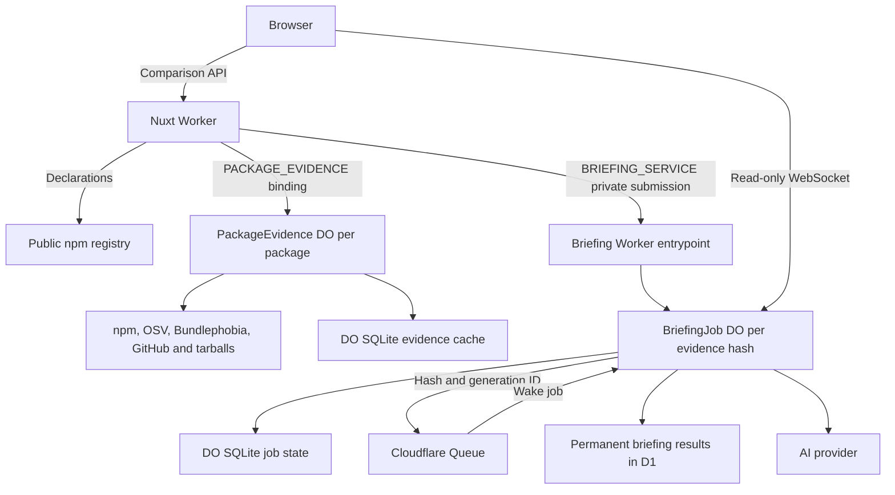

# Comparison architecture

The system compares two versions of one public npm package. It presents declarations first, then measurements and supplementary AI notes. It does not assess a consumer project or approve an upgrade; see [product meaning and limitations](../product/meaning-and-limitations.md).

This document describes current source-backed behavior, not the state of a deployed environment. [Evidence architecture](evidence.md) owns collection, caching, admission, and provider failure details. [Briefing architecture](briefing.md) owns durable generation and browser subscriptions.

## Shared module organization

`shared/` groups cross-runtime contracts and helpers by domain. `comparison/` owns comparison result contracts, with `briefing/` for content and job/service protocols, `evidence/` for provider/archive and evidence-binding contracts, and `package/` for registry metadata, search, and semver helpers. `telemetry/` owns diagnostic contracts, sanitization, trace context, and logging; `site/` owns public-origin and URL handling. `db/` retains the database schemas and driver type declarations, while root `cloudflare.d.ts` declares runtime bindings. Import modules directly; these folders do not add barrel exports or change runtime ownership.

## Runtime ownership

| Owner                                                          | Responsibilities                                                                                                                | Does not own                                               |
| -------------------------------------------------------------- | ------------------------------------------------------------------------------------------------------------------------------- | ---------------------------------------------------------- |
| Browser                                                        | Reactive comparison queries, result rendering, briefing submission and read-only job subscription                               | Trusted evidence, provider credentials, durable jobs       |
| Nuxt Worker                                                    | SSR declarations and stored-result hydration, public comparison routes, request validation, private evidence and briefing calls | Archive inspection, AI generation, D1                      |
| Evidence Worker / per-package `PackageEvidence` Durable Object | Provider collection, verified archive inspection, SQLite evidence cache, bounded briefing packet                                | AI generation or stored briefing results                   |
| Briefing Worker / per-hash `BriefingJob` Durable Object        | Private submission, durable job state, generation, public read-only sockets                                                     | Registry/provider evidence collection                      |
| Cloudflare Queue                                               | Delivers a hash and generation ID to wake its job                                                                               | Evidence packet, prompt, credentials, generation ownership |
| D1                                                             | Permanent validated briefing results, first-writer-wins by evidence hash                                                        | Evidence cache, provider budget enforcement                |



The [root bindings](../../wrangler.jsonc) give Nuxt access to the evidence DO namespace and named briefing entrypoint. The [evidence Worker](../../workers/evidence/index.ts) has no public application endpoint. The [briefing public entrypoint](../../workers/briefing/index.ts) accepts only allowed-origin socket upgrades for existing job identities; it cannot submit a generation. Briefing D1, Queue, job bindings, and socket configuration belong to the [briefing Worker configuration](../../workers/briefing/wrangler.jsonc), not Nuxt.

## Diagnostic transport

Existing browser, Nuxt submission, and briefing generation instrumentation can export sanitized logs and completed spans through Effect's OTLP/HTTP exporters while retaining JSON console output. Console records pass the same scalar field allowlist as export, so unlisted fields, selector values, and raw causes never reach either sink. Export is disabled unless configured. The browser uses same-origin `/api/telemetry/v1/{logs,traces}` ingestion; Nuxt validates bounded JSON, forces the browser resource identity, and forwards to the privately configured OTLP endpoint. Workers export directly to their owning endpoint. Nuxt forwards only a formatted `traceparent` to the private evidence binding; each evidence request span follows it, while shared evidence collections run under independent roots that joiners link to by trace and span ID. The built Nuxt Worker intercepts telemetry at its entry before Nitro's Cloudflare adapter buffers POST bodies; other requests delegate to the official adapter unchanged. Only the Cloudflare production Rollup entry is overridden; prerender and HMR retain Nitro's own entries. The direct `nitropack` pin must stay aligned with Nuxt's adapter version when upgrading. Nuxt HMR uses a streaming H3 request bridge for the same ingestion policy. No diagnostic path generates briefings or changes evidence/job ownership.

[Telemetry decoding](../../shared/telemetry/telemetry.defs.ts) selects a schema-composed ingress decoder with `decodeTelemetryPayload(signal)(value)`. Its [bounded input schema](../../shared/telemetry/telemetryBounds.ts) checks traversal budgets and cycles before OTLP decoding or sanitization; downstream helpers receive validated types. Header and persisted trace-context readers likewise compose schema decoders with typed normalization, retaining their empty-header and absent-context fallbacks. Lifecycle-hook lookup inspects runtime containers shallowly, without reading unrelated fields, and invokes `waitUntil` with its original scope as receiver.

Durable `briefing.job.settled` follows a successful terminal put; recovery lookup observations are not settlement claims. Dispatch and Queue records (`briefing.dispatch.decision`, `briefing.queue.decision`) explain attempts and ack/retry without changing fencing or work ownership.

Failure observability is automatic when telemetry is enabled: the browser captures Vue/app/chunk errors, uncaught exceptions and promise rejections through a Faro Web SDK instrumentation bridged into the app telemetry runtime, and Nuxt captures SSR render failures and Nitro handler errors for a `can-i-update-nuxt` resource. All captured failure records pass through the shared `shared/telemetry/telemetryError.ts` policy first: reviewed error types, error source names, and code-file-only stack locations; exception messages are never exported; telemetry ingress recursion, expected sub-500 outcomes and aborted requests are excluded server-side. Disabling the telemetry flag or losing the sink never changes application outcomes.

The generation acceptance root ends at acceptance; the later provider execution is its child using persisted context. Submission server spans link to that independent root when joining queued/running work. Logs and spans carry validated public package identity in `comparison.package.name`, and resolved releases in `comparison.version.from` / `comparison.version.to`. Identity is attached only after registry resolution. The page root carries operation context only, and failed lookups carry no package or version identity. Nuxt derives identity from its trusted evidence packet; requested selectors are never recorded. Generation records use their own persisted packet. These attributes are not resource identities or metric labels. Exported records exclude provider bodies, credentials, prompts, evidence packets, full URLs, and raw exception text. Missing telemetry is not proof an operation did not run. Query exported records in the Grafana UI.

Declaration and measurement queries each settle through `runComparisonTier` at their own query owner, so the page's tiers are observable without a page-level state mirror. Each settlement emits `comparison.tier.settled` with fixed `operation` (`declarations` or `measurements`), `outcome`, `retainedData` (whether the query already held data when its request started), and a decimal-string `durationMs`. A rejection records `failure`, or `cancelled` when its signal aborted, and rethrows the original error. Measurement `partial` means advisory, tarball, or bundle evidence was unavailable. Declarations have no `partial` outcome. A throwing outcome classifier omits only the outcome field; it never changes the query result.

[The subscription owner](../../app/composables/briefingSubscription.ts) deduplicates queued/running transitions and distinguishes terminal, timeout, malformed frame, transport/disconnection exhaustion, and navigation cancellation; reconnect remains read-only and cancellation is not an error alert. All instrumentation is guarded so classifier, formatter, and exporter failure cannot replace application results.

## Public comparison contracts

All three routes decode the package name and trim nonempty `from`/`to` inputs, each bounded to 256 characters. The registry resolves inputs such as tags to manifest versions. The page passes the returned exact versions to its later-tier queries; the routes themselves share parameter validation rather than requiring browser inputs to be exact versions.

| Route                                                                    | Result and boundary                                                                                                                                                                                                      |
| ------------------------------------------------------------------------ | ------------------------------------------------------------------------------------------------------------------------------------------------------------------------------------------------------------------------ |
| `GET /api/package/{encodedPackageName}/compare?from=…&to=…`              | Resolved manifests and declaration comparison: dependencies, peers, Node requirement, module/export/type declarations, licenses, install scripts. No evidence binding, GitHub request, archive inspection, or inference. |
| `GET /api/package/{encodedPackageName}/compare/measurements?from=…&to=…` | Size/advisory comparison and per-version evidence, including compact tarball summaries. Uses the private evidence backend; no per-file inventory or changelog bodies reach this response.                                |
| `GET /api/package/{encodedPackageName}/compare/briefing?from=…&to=…`     | Read-only stored-result lookup by the server-built evidence hash. Returns `missing` or validated `available`; it never reads or mutates a job, enqueues work, or generates. Errors are sanitized service failures.       |
| `POST /api/package/{encodedPackageName}/compare/briefing?from=…&to=…`    | Builds evidence server-side and submits it privately. Returns `200` with a stored briefing, `202` with pending job identity/socket information, or a sanitized refusal. Can initiate paid generation; it is not a read.  |

Sources: [collection and validation](../../server/comparison/collect.ts), [declaration comparator](../../server/comparison/declarations/compare.ts), [measurement comparator](../../server/comparison/measurements/compare.ts), [declarations route](../../server/api/package/[packageName]/compare/index.get.ts), [measurements route](../../server/api/package/[packageName]/compare/measurements/index.get.ts), [stored-briefing read route](../../server/api/package/[packageName]/compare/briefing/index.get.ts), [briefing submission route](../../server/api/package/[packageName]/compare/briefing/index.post.ts), and [evidence client boundary](../../server/api/package/[packageName]/compare/_internals/evidenceClient.ts).

The browser supplies only package/version selectors, never trusted comparison facts. Measurements responses are decoded against the complete shared response schema, checked against the requested package/versions, and reject excess fields, including archive inventories. Briefing packets and service responses are likewise schema-decoded. Missing bindings, transport failures, upstream failures, or protocol violations become sanitized service failures rather than falling back to frontend collection or generation.

## Declaration comparison invariants

The [declaration comparator](../../server/comparison/declarations/compare.ts) runs on resolved manifest declarations without extra I/O or executing package code. Direction is the requested `from` → `to`; identical versions and downgrades do not take a separate approval path.

- Dependency changes cover runtime and optional requirements, not dev dependencies. Optional requirements override same-name runtime declarations; a category move is one change. Peers are separate and include required/optional transitions.
- Declaration maps emit sorted differences. Scalar/composite results retain before/after values and `changed`; presence flags distinguish an absent declaration from explicit JSON `null`.
- Conditional export/type mapping order is preserved because precedence matters. These are declaration comparisons, not semantic API tests or proof that imports work.
- Node range changes are textual declaration changes, not range-containment analysis. License changes are facts, not legal advice. Install scripts cover explicit lifecycle commands, not inferred execution behavior.

These rules explain the factual contract; [product limitations](../product/meaning-and-limitations.md) defines what consumers may conclude from it.

## Loading sequence

[Page orchestration](../../app/composables/useComparisonPage.ts) creates all reactive queries before awaiting the server declarations prefetch. The [homepage](../../app/pages/index.vue) may stream, but [Nuxt configuration](../../nuxt.config.ts) disables streaming on non-root routes so comparison SSR can finish its optional stored-result and measurements reads before setting response headers. The package description arrives with declaration rows. Crawler user agents are excluded by Nuxt.

```mermaid
sequenceDiagram
  participant Browser
  participant Nuxt
  participant Registry as npm registry
  participant Evidence as PackageEvidence DO
  participant Briefing as Briefing service/job
  Nuxt->>Registry: Resolve both declaration manifests concurrently
  Registry-->>Nuxt: Resolved versions and declarations
  Nuxt->>Evidence: Build packet for a read-only stored-result lookup
  Evidence-->>Nuxt: Server-built packet
  Nuxt->>Briefing: Read D1 by evidence hash (no job lookup or mutation)
  alt Validated stored success
    Briefing-->>Nuxt: available
    Nuxt->>Evidence: GET measurements
    Evidence-->>Nuxt: Measurement comparison and summaries
    Note over Nuxt: Seed existing briefing and measurements queries; mark complete HTML cacheable
  else Missing result or read failure
    Briefing-->>Nuxt: missing or sanitized service error
    Note over Nuxt: Do not submit or generate during SSR; keep HTML uncacheable
  end
  Nuxt-->>Browser: Complete HTML and hydrated queries
  Note over Browser: On a miss, resolved-version client queries continue independently
  opt No hydrated briefing result
    Browser->>Nuxt: POST briefing
    Nuxt->>Evidence: Collect or reuse complete evidence and pack bounded packet
    Evidence-->>Nuxt: Server-built packet
    Nuxt->>Briefing: Submit packet
    alt Stored result
      Briefing-->>Nuxt: available
      Nuxt-->>Browser: 200 with briefing
    else Pending job
      Briefing-->>Nuxt: queued or running with hash, URL, revision
      Nuxt-->>Browser: 202
      Browser->>Briefing: Read-only WebSocket subscription
      Briefing-->>Browser: Progress, then terminal result
    end
  end
```

On a stored-result miss, measurements and briefing remain **parallel client queries after declarations**, not a serial measurements-then-AI pipeline. A stored success instead seeds the existing briefing query during SSR and prefetches measurements; it never submits or generates. Briefing independently gathers its own complete server-side evidence; it does not consume the browser's measurements response. Shared evidence cache misses may coalesce in the backend. Opening the notes panel does not trigger generation: the client briefing query is enabled automatically for a resolved comparison.

SSR-prefetched query data is dehydrated by the [Vue Query plugin](../../app/plugins/vue-query.ts) and hydrated in the browser. Declarations always prefetch on SSR. The server checks for a stored briefing but only seeds the query on a validated D1 hit; it fetches measurements only for that hit. Missing results and evidence/storage failures leave the browser's existing POST flow intact, and failed SSR measurement state is removed rather than dehydrated.

## Edge response caching

The prerendered homepage is served as a static asset, so [`public/_headers`](../../public/_headers) supplies its one-year Cloudflare edge TTL with browser revalidation (`public, max-age=0, must-revalidate`). Nitro response hooks do not run for this static response.

The [response policy](../../server/plugins/responseCache.ts) caches only successful GET HTML handled by Nitro: `/`, `/privacy`, and `/about` receive a one-year Cloudflare edge TTL, and a comparison page receives 12 hours only after SSR has hydrated a validated stored briefing and successful measurements. `Cache-Control: no-cache` makes browsers revalidate; Cloudflare's CDN-specific header carries the edge TTL with `must-revalidate` to prevent stale serving beyond expiry. Misses, pending/failed briefings, evidence/storage errors, other routes, APIs, and non-HTML responses use `no-store`. Comparison routes disable SSR streaming so the eligibility decision and headers are final before the response starts.

The [frontend Wrangler config](../../wrangler.jsonc) enables native Workers Cache only for hosted `env.preview` (stage). Cross-version sharing stays disabled, so a deployment starts with a cold Worker-version cache; platform eviction can expire an entry sooner, so the one-year home, privacy, and about TTLs are not guarantees of retention until deploy. The homepage, privacy, about, and comparison HTML are public and identical for authorized visitors; stage remains behind Cloudflare Access. Local built preview and production do not enable this cache.

## Identity and freshness

Three identities serve different purposes:

- **Browser query:** tier, package, and selected versions. Declarations use the requested selectors; later tiers use resolved versions. Declaration, measurement, and briefing caches are separate.
- **Evidence object:** package name. Provider-specific keys let evidence be reused across comparison pairs; cache lifetimes and integrity policies are detailed in [evidence architecture](evidence.md).
- **Briefing job/result:** exact bounded evidence hash. Different users submitting identical evidence share work and stored results. The same version pair with changed evidence can produce a different hash; see [briefing identity and spending controls](briefing.md).

[Declarations](../../app/composables/packageComparisonQueryOptions.ts), [measurements](../../app/composables/packageMeasurementsQueryOptions.ts), and [briefing](../../app/composables/packageBriefingQueryOptions.ts) use a 60-second browser stale time, five-minute client garbage-collection time, no window-focus refetch, and no query-level automatic retries. The briefing query has its own narrowly scoped submission retry and socket reconnect policy, described in its subsystem document.

The public declarations route passes no persistent evidence-cache service to its collector. The backend later resolves manifests again through its own cache. Exact versions stabilize the selected releases, **not an atomic snapshot of all mutable provider evidence across routes**. Independent requests, provider freshness, and retained browser data can differ. Provider failures remain explicit uncertainty rather than zero measurements or a no-advisory conclusion.

## Failure, cancellation, and recovery boundaries

| Path                                                                                    | Current behavior                                                                                                                                                                                                              | What remains usable                                                                                                                                                                                                  |
| --------------------------------------------------------------------------------------- | ----------------------------------------------------------------------------------------------------------------------------------------------------------------------------------------------------------------------------- | -------------------------------------------------------------------------------------------------------------------------------------------------------------------------------------------------------------------- |
| Invalid selectors or registry/declarations failure                                      | Validation or collection rejects. Failed SSR prefetch is removed; the browser gets its own attempt. A client declaration error renders the comparison error surface. Without resolved data, later-tier queries stay disabled. | Route-only shell; no invented comparison facts.                                                                                                                                                                      |
| One measurement provider is unavailable or incomplete                                   | Collector retains unrelated evidence and returns coverage/status/reasons where possible.                                                                                                                                      | Declarations and other successful measurements; no inference of a fix from incomplete advisory coverage.                                                                                                             |
| Measurements binding/backend/protocol failure                                           | Public measurements route returns sanitized `503`. Without cached data, affected UI becomes unavailable.                                                                                                                      | Declarations; briefing can succeed independently if its own collection succeeds.                                                                                                                                     |
| Measurement refetch fails after data was cached                                         | Cached measurements remain renderable; unavailable is only set for an error without data.                                                                                                                                     | Previously fetched measurements, not a guarantee of fresh evidence.                                                                                                                                                  |
| Evidence backend unavailable for briefing                                               | Submission cannot build a packet and fails; there is no frontend fallback.                                                                                                                                                    | Declarations and any already-returned measurements. A shared evidence outage can affect both later tiers.                                                                                                            |
| Briefing refusal, generation/storage failure, invalid stream, or exhausted subscription | Notes become unavailable or the briefing query errors. Exact recovery/retry paths are in [briefing architecture](briefing.md).                                                                                                | Factual comparison; inference is never required to render it.                                                                                                                                                        |
| Browser changes comparison or unmounts                                                  | When the last query observer detaches, its abort signal cancels the client fetch/subscription; a new comparison key owns separate query/status state.                                                                         | No application cancellation path stops shared evidence work when one browser leaves; runtime disconnect behavior is not specified by the evidence handlers. Accepted briefing jobs have their own durable lifecycle. |
| Socket disconnect                                                                       | Browser reconnects to read the job snapshot within bounded attempts and one subscription deadline; it does not POST again just to reconnect.                                                                                  | Durable job and results can outlive the subscriber.                                                                                                                                                                  |

Sources: [page orchestration](../../app/composables/useComparisonPage.ts), [comparison rendering](../../app/components/comparison/ComparisonDetails.vue), [query cancellation/subscription](../../app/composables/packageBriefingQueryOptions.ts), and the linked subsystem documents. Provider/storage/admission failures and job recovery are expanded there rather than duplicated here.

Independence means declarations do not call the evidence service or AI provider, and notes do not gate factual rendering. It does **not** imply all tiers have isolated account resources: measurements and briefing share an evidence backend, and admission limits are not account-wide guarantees.

Hash-based coalescing and result reuse are a local duplicate-spend control: multiple users do not each buy the same successful evidence snapshot. They are not a fixed monetary budget. The external OpenRouter budget is the separate spending cap when that provider is used; the application does not implement an account-wide budget of its own.
